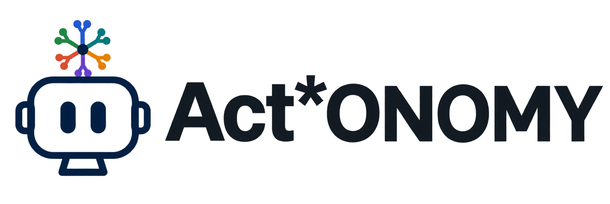
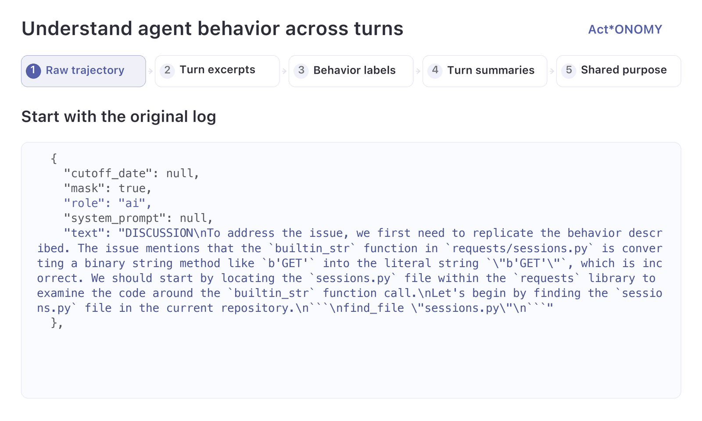

<p align="center">
  
</p>

<h1 align="center">Actonomy: A Taxonomy for Describing and Analyzing Agent Behavior</h1>

<h3 align="center">A shared vocabulary for understanding, describing and analysing agent runtime behavior</h3>

<p align="center">
  English · <a href="README.zh.md">中文</a><br>
  <strong>How to Interpret Agent Behavior</strong><br>
  <a href="https://gaojie058.github.io/">Jie Gao</a>, Kaiser Sun, Jen-tse Huang, Katherine Van Koevering, Sijie Ji, Heyuan Huang,<br>
  Weiyan Shi, Zhuoran Lu, Ziang Xiao, Daniel Khashabi, Mark Dredze<br>
  <a href="https://neurips.cc/Conferences/2026"></a><br>
  <a href="https://gaojie058.github.io/Act-onomy/">Project website</a> ·
  <a href="https://arxiv.org/abs/2605.13625">Paper (arXiv:2605.13625)</a> ·
  <a href="data/taxonomy/taxonomy.md">Taxonomy</a>
</p>

**Actonomy** is an extensible taxonomy for **describing and analyzing agent behavior** at runtime. This official repository for [*How to Interpret Agent Behavior*](https://arxiv.org/abs/2605.13625) provides the codebook, datasets of behavior descriptions, and tools for automated agent trajectory analysis.

The name combines **action** and **taxonomy**. **Actonomy** is styled **ACT\*ONOMY** in the paper and logo, and also appears as **Act-onomy** (the GitHub repository name) and **Act·onomy**. These names refer to the same research project.

Developed through Grounded Theory, the taxonomy comprises **10 actions, 46 subactions, and 120 leaf categories**. Use it to annotate agent traces, compare behavioral profiles across agents, and examine patterns associated with successes and failures.

<p align="center">
  <br>
  <em>Raw trajectory → Turn excerpts → Behavior labels → Turn summaries → Shared purpose.</em>
</p>

The animation follows T1–T4 of the [original requests-2317 log](trajectory%20annotation%20examples/case2_swe_agent_two_traces/trace1_psf__requests-2317.json). Two example pages show highlighted sentences from T1–T2 with **Action → Subaction → Leaf** labels taken verbatim from the [case-study annotations](trajectory%20annotation%20examples/case2_swe_agent_two_traces/trace1_psf__requests-2317.annotated.json). The four turn summaries then reveal a shared purpose. [Three-level annotation example](assets/semantic_workflow_labels.png) · [Static summary](assets/semantic_workflow.png).

## Website

The [project website](https://gaojie058.github.io/Act-onomy/) includes the taxonomy explorer, two SWE-agent case studies, and a SWE-chat example with human feedback. GitHub Pages serves the static files in [`docs/`](docs/) from `main`; see [website maintenance notes](docs/README.md).

## When to use Act\*ONOMY

| Your goal                                          | Start here                                                             |
|----------------------------------------------------|------------------------------------------------------------------------|
| Understand an agent's reasoning and actions        | [Trajectory analysis](tools/trace-qualitative-analyst/README.md)       |
| Study how a human steers an agent                  | [Human–agent analysis](tools/human-trace-qualitative-analyst/SKILL.md) |
| Compare behavioral profiles across agents or tasks | [Case studies](trajectory%20annotation%20examples/README.md)                                     |
| Identify behaviors missing from the vocabulary     | [Discovery workflow](tools/discovery-qualitative-analyst/SKILL.md)     |

## Quickstart

**Download skills → Install skills → Input a trajectory → Generate a report**

Analysis runs in a compatible AI assistant with the skills loaded. The assistant reads the codebook, annotates evidence, and generates the report; `actonomy.py` provides parsing and rendering helpers, not automatic trajectory analysis.

### 1. Download skills

Download this repository; the skill bundles are in [`tools/`](tools/).

```bash
git clone https://github.com/gaojie058/Act-onomy.git
cd Act-onomy
```

### 2. Install skills

Open the repository in your assistant and ask:

```text
Install tools/trace-qualitative-analyst and tools/human-trace-qualitative-analyst
using this environment's skill installation workflow. Keep both complete
folders side by side, including their references, scripts, and assets.
```

The human-interaction skill depends on the trace skill. The assistant needs local file access and Python **3.10+** to run the bundled scripts.

### 3. Input a trajectory

Provide your trajectory file and ask:

```text
Use trace-qualitative-analyst to analyze my trajectory at <path/to/trajectory.json>.
Annotate behavior with verbatim evidence from the trajectory and generate
outputs/trajectory.annotated.json and outputs/trajectory.html.
```

For a Claude Code session with human interactions, use `human-trace-qualitative-analyst` and provide the session `.jsonl` file. See the [full quickstart](docs/quickstart.md) for input formats and a bundled example.

### 4. Generate a report

The assistant saves the annotated JSON and an interactive HTML report. Open **`outputs/trajectory.html`** in your browser to explore turn-by-turn behavior, evidence quotes, and action distributions.

## Repository layout

```text
.
├── data/
│   ├── corpus/
│   ├── large_corpus/
│   └── taxonomy/
├── tools/
│   ├── discovery-qualitative-analyst/
│   ├── extension-tool/
│   ├── human-trace-qualitative-analyst/
│   └── trace-qualitative-analyst/
├── trajectory annotation examples/
│   ├── case1_three_agents/
│   ├── case2_swe_agent_two_traces/
│   └── crosswalk/
├── assets/
├── docs/
├── CITATION.cff
├── LICENSE
└── LICENSE-codebook
```

| Directory | Contents |
| --- | --- |
| [data/](data/README.md) | Research corpora, canonical taxonomy, and development snapshots |
| [tools/](tools/) | Four skill bundles with instructions, scripts, and supporting assets |
| [trajectory annotation examples/](trajectory%20annotation%20examples/README.md) | Agent trajectories, annotated reports, and MAST/CoALA crosswalks |
| [docs/](docs/README.md) | Static project website and downloadable research artifacts |
| [assets/](assets/) | Act\*ONOMY branding, workflow animations, and static previews |

<!-- ## Data and examples

| Resource                                                     | Included in this repository                                                 |
|--------------------------------------------------------------|-----------------------------------------------------------------------------|
| [Grounded-theory corpus](data/corpus/)                       | 35 papers; 664 construction and 116 held-out behavior sentences             |
| [Codebook](data/taxonomy/)                                   | CSV/JSON sources, a readable taxonomy, and development snapshots            |
| [Larger corpus](data/large_corpus/)                          | 3,455 behavior sentences; the current paper index has 211 records           |
| [Three-agent comparison](trajectory%20annotation%20examples/case1_three_agents/)       | 300 source trajectory JSON files (100 per agent) and aggregate reports      |
| [Two SWE-agent traces](trajectory%20annotation%20examples/case2_swe_agent_two_traces/) | Raw JSON, annotated JSON, and saved HTML for requests-2317 and django-14411 |
| [MAST / CoALA crosswalks](trajectory%20annotation%20examples/crosswalk/)               | Mapping script and saved tables; mappings are analytic judgments            |

The [data guide](data/README.md) explains corpus splits, the paper-index count discrepancy, and local-only materials. -->

<!-- ## Development and contributing

```bash
make check      # Codebook consistency, documentation links, and regression tests
make demo       # Render the bundled example
make crosswalk  # Write regenerated mappings to outputs/crosswalk/
```

See [CONTRIBUTING.md](CONTRIBUTING.md) for development setup and evidence requirements for taxonomy proposals. The existing pre-release pause on external contributions remains in effect. -->

## Citation

If you use the Actonomy taxonomy, datasets, or analysis tools, please cite the accompanying paper:

```bibtex
@article{gao2026interpret,
  title   = {How to Interpret Agent Behavior},
  author  = {Gao, Jie and Sun, Kaiser and Huang, Jen-tse and Van Koevering, Katherine and Ji, Sijie and Huang, Heyuan and Shi, Weiyan and Lu, Zhuoran and Xiao, Ziang and Khashabi, Daniel and Dredze, Mark},
  journal = {arXiv preprint arXiv:2605.13625},
  year    = {2026},
  doi     = {10.48550/arXiv.2605.13625},
  url     = {https://arxiv.org/abs/2605.13625}
}
```

Machine-readable citation metadata is available in [CITATION.cff](CITATION.cff).

## License

- **Source code and skill templates:** [MIT](LICENSE).
- **Codebook content and labeled datasets:** [CC BY 4.0](LICENSE-codebook).
- **Third-party case-study materials:** retain their original licenses and attribution; see the paper's appendix.
