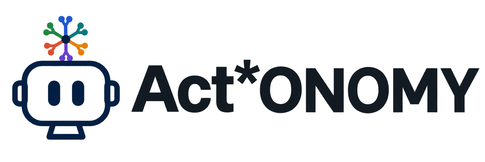
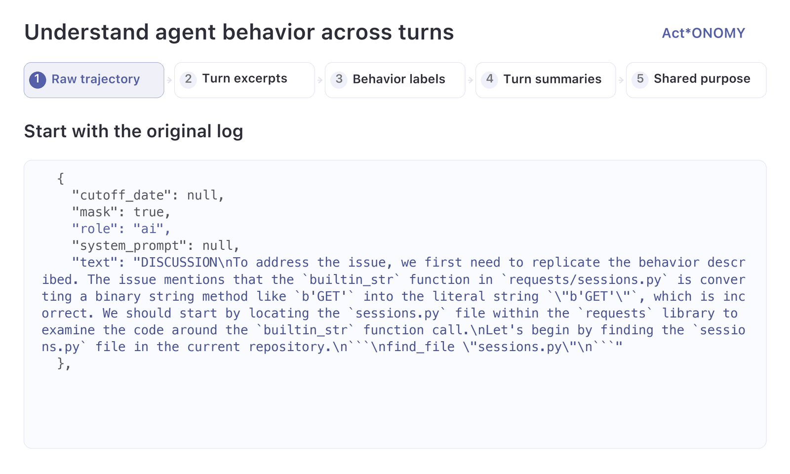

<p align="center">
  
  &nbsp;&nbsp;&nbsp;
  <a href="https://neurips.cc/Conferences/2026"></a>
</p>

<p align="center">
  <a href="LICENSE"></a>
  <a href="LICENSE-codebook"></a>
  <a href="data/taxonomy/taxonomy.md"></a>
  <a href="tools/trace-qualitative-analyst/README.md"></a>
</p>

<h3 align="center">用于理解 AI 智能体运行时行为的共同词汇</h3>

<p align="center">
  <a href="README.md">English</a> · 中文<br>
  <strong>How to Interpret Agent Behavior</strong><br>
  <a href="https://arxiv.org/abs/2605.13625">论文</a> ·
  <a href="#快速上手">快速上手</a> ·
  <a href="data/taxonomy/taxonomy.md">行为分类</a> ·
  <a href="https://github.com/gaojie058/iab-actonomy/blob/gh-pages/README.md">官网文档</a> ·
  <a href="CONTRIBUTING.md">贡献指南</a>
</p>

**Act\*ONOMY** 用 **10 类动作、46 类子动作、120 个叶级实例**描述 AI 智能体在运行时做了什么。仓库提供基于扎根理论构建的 codebook、逐句引用证据的轨迹分析工具，以及随新行为出现而扩展分类体系的流程。

<table align="center">
  <tr><th align="left">流程演示 · Workflow Demo</th></tr>
  <tr><td align="center">
    <br>
    <em>原始轨迹 → 逐轮摘录 → 行为标签 → 逐轮总结 → 共同目标。</em>
  </td></tr>
</table>

动图展示 [requests-2317 原始日志](trajectory%20annotation%20examples/case2_swe_agent_two_traces/trace1_psf__requests-2317.json) 的连续四轮 T1–T4。Behavior labels 用 T1、T2 两页示例说明：高亮具体语句，通过编号对应 **Action → Subaction → Leaf** 三层标签。标签原样取自[案例真实标注](trajectory%20annotation%20examples/case2_swe_agent_two_traces/trace1_psf__requests-2317.annotated.json)，随后汇总四轮行为与共同目标。[三层标注示例](assets/semantic_workflow_labels.png) · [静态总结](assets/semantic_workflow.png)。

官网由独立的 [`gh-pages` 分支](https://github.com/gaojie058/iab-actonomy/tree/gh-pages)根目录发布；`main` 保留代码与数据。网站维护方式见[官网文档](https://github.com/gaojie058/iab-actonomy/blob/gh-pages/README.md)。

## 适用场景

| 你的目标 | 从这里开始 |
| --- | --- |
| 理解智能体的推理与动作 | [轨迹分析](tools/trace-qualitative-analyst/README.md) |
| 研究用户如何引导智能体 | [人机交互分析](tools/human-trace-qualitative-analyst/SKILL.md) |
| 比较不同智能体或任务的行为特征 | [案例](trajectory%20annotation%20examples/README.md) |
| 发现现有词汇未覆盖的行为 | [发现与扩展流程](tools/discovery-qualitative-analyst/SKILL.md) |
| 扩展分类并核对依赖文件 | [Codebook 维护](tools/extension-tool/SKILL.md) |

`trace-qualitative-analyst` 分析智能体自主执行的轨迹；`human-trace-qualitative-analyst` 用于有人类参与交互的轨迹，额外标注人的指令、反馈及其如何引导智能体。

## 快速上手

**下载 Skills → 安装 Skills → 输入轨迹 → 输出报告**

分析由加载 Skill 的兼容 AI 助手完成：助手读取 codebook、引用证据并标注，再生成报告。`actonomy.py` 提供解析和渲染等辅助功能，不能直接完成轨迹分析。

### 1. 下载 Skills

下载本仓库；Skill 包位于 [`tools/`](tools/) 目录。

```bash
git clone https://github.com/gaojie058/iab-actonomy.git
cd iab-actonomy
```

### 2. 安装 Skills

在 AI 助手中打开仓库，并输入：

```text
请按照当前环境的 Skill 安装方式，安装 tools/trace-qualitative-analyst 和
tools/human-trace-qualitative-analyst。保留各自完整的目录内容，包括 references、
scripts 和 assets，并将两个 Skill 放在同一父目录下。
```

人机交互 Skill 依赖轨迹分析 Skill。助手需要能够读写本地文件，并使用 **Python 3.10+** 运行配套脚本。

### 3. 输入轨迹

提供轨迹文件，并输入：

```text
请使用 trace-qualitative-analyst 分析 <轨迹文件路径.json>，
引用轨迹原文作为行为标注的证据，并生成 outputs/trajectory.annotated.json
和 outputs/trajectory.html。
```

如果是包含用户交互的 Claude Code 会话，改用 `human-trace-qualitative-analyst`，并提供会话 `.jsonl` 文件。Skill 的用法和目录结构见[轨迹分析说明](tools/trace-qualitative-analyst/README.md)。

### 4. 输出报告

助手保存标注 JSON 和交互式 HTML 报告。用浏览器打开 **`outputs/trajectory.html`**，即可查看逐轮行为、原文证据和动作分布。

## 仓库结构

```text
.
├── data/
│   ├── corpus/
│   ├── large_corpus/
│   └── taxonomy/
├── tools/
│   ├── discovery-qualitative-analyst/
│   ├── extension-tool/
│   ├── human-trace-qualitative-analyst/
│   └── trace-qualitative-analyst/
├── trajectory annotation examples/
│   ├── case1_three_agents/
│   └── case2_swe_agent_two_traces/
├── assets/
├── CITATION.cff
├── LICENSE
└── LICENSE-codebook
```

| 目录 | 内容 |
| --- | --- |
| [data/](data/README.md) | 研究语料、正式分类数据与开发历史版本 |
| [tools/](tools/) | 四个 skill 包，包含说明、脚本及配套资源 |
| [trajectory annotation examples/](trajectory%20annotation%20examples/README.md) | 智能体轨迹与标注报告 |
| [assets/](assets/) | Act\*ONOMY 品牌素材、工作流动图与静态预览 |

## 数据与案例

| 资源 | 仓库包含的内容 |
| --- | --- |
| [扎根理论语料](data/corpus/) | 35 篇论文；664 条构建集句子与 116 条留出集句子 |
| [Codebook](data/taxonomy/) | CSV/JSON、可读分类表与历史版本 |
| [扩展语料](data/large_corpus/) | 3,455 条行为句子；当前论文索引含 211 条记录 |
| [三种智能体比较](trajectory%20annotation%20examples/case1_three_agents/) | 300 条原始轨迹 JSON（每种智能体各 100 条）及汇总报告 |
| [两条 SWE-agent 轨迹](trajectory%20annotation%20examples/case2_swe_agent_two_traces/) | requests-2317 和 django-14411 的原始 JSON、标注 JSON 与 HTML |

[数据说明](data/README.md)介绍划分方式、论文索引数量差异以及仅本地保留的材料。

## 开发与贡献

```bash
make check      # Codebook 一致性、文档链接及回归测试
make demo       # 渲染示例
```

开发步骤和分类扩展的证据要求见[贡献指南](CONTRIBUTING.md)。原有的预发布期间暂停外部贡献政策保持有效。

## 引用

研究中使用 Act\*ONOMY 时，请引用 [How to Interpret Agent Behavior](https://arxiv.org/abs/2605.13625)。BibTeX 见[英文 README](README.md#citation)，机器可读元数据见 [CITATION.cff](CITATION.cff)。

## 许可

- **代码与 skill 模板：**[MIT](LICENSE)。
- **Codebook 内容与标注数据：**[CC BY 4.0](LICENSE-codebook)。
- **第三方案例材料：**保留原许可与署名，详见论文附录。
